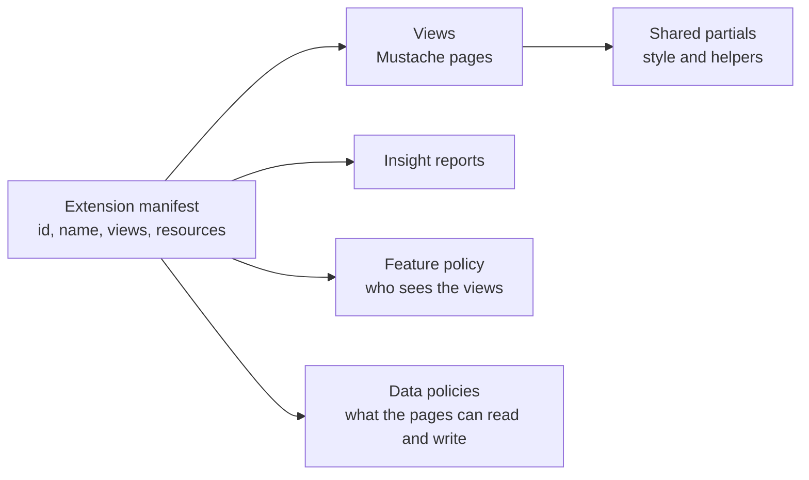
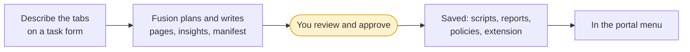
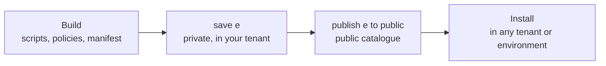

# Building extensions

How extensions work, building one with Fusion AI, the manifest, writing pages, insights and policies, publishing, and an HTML components example.

Generated from the OpenDataDSL documentation (https://doc.opendatadsl.com/docs).


---

<!-- source: extensions/building-extensions/01-how-extensions-work.md -->

# How extensions work

An **extension** adds your own screens to the OpenDataDSL portal and Excel add-in: a menu item with tabs that show your data the way your team works with it, with insight reports alongside. The extensions in this section of the documentation, such as [Fusion AI](https://doc.opendatadsl.com/docs/extensions/fusion-ai/overview), [Composer](https://doc.opendatadsl.com/docs/extensions/composer/overview) and [Validation](https://doc.opendatadsl.com/docs/extensions/validation/overview), are built in exactly the same way as the ones you build yourself.

---

## What an extension is made of



| Part | What it is |
|-|-|
| **Manifest** | The extension itself: its id, name, icon and description, its views, and the resources it needs. See [The extension manifest](https://doc.opendatadsl.com/docs/extensions/building/manifest). |
| **Views** | The pages users open. Each view is a Mustache script of HTML, CSS and JavaScript that reads and writes platform data. See [Writing pages](https://doc.opendatadsl.com/docs/extensions/building/pages). |
| **Shared partials** | Scripts the views include, typically the extension's own styles and JavaScript helpers |
| **Insights** | Report pages listed on the view's **Insights** tab. See [Insights and policies](https://doc.opendatadsl.com/docs/extensions/building/insights-and-policies). |
| **Feature policy** | Decides which users see the extension's views |
| **Data policies** | Give users access to the data the pages read and write, when existing policies do not |

The manifest lists every script, insight report and policy the extension uses as its **resources**, so they are installed together.

---

## Where an extension appears

Each view says where it goes in the portal menu:

| Property | Meaning |
|-|-|
| **section** | The section of the left-hand menu, for example **Extensions**, **Information** or **Manage** |
| **name** | The menu item in that section. Views with the same name are tabs of one menu item. |
| **tabname** | The tab within the menu item. A tab called **Apps** collects views as apps, each with its own **appname**. |
| **insights** | Adds an **Insights** tab listing the extension's insight reports |
| **excel** | Shows the view in the Excel add-in instead |

For example, the Fusion AI extension puts seven views, all named **Fusion AI**, in the **Information** section, so they appear as the tabs Studio, Agents, Assistants, Tools, Playbooks, Tasks and Architecture.

---

## Private and public extensions

| | Where it lives | Who can use it |
|-|-|-|
| **Private** | Your tenant | The people your feature policy includes. An extension you create is private. |
| **Public** | The public extension catalogue | Any OpenDataDSL tenant that installs it. Publishing needs a publisher code from OpenDataDSL. |

An extension's id is its **publisher** and **code** joined with a dot, for example `acme.positions`. Use your company's publisher code even for private extensions, so the id is ready if you publish it later. See [Saving, installing and publishing](https://doc.opendatadsl.com/docs/extensions/building/publishing).

---

## Three ways to build an extension

| Way | Best when |
|-|-|
| **With a Fusion AI playbook** | You can describe the tabs you want. Fusion plans the extension, writes every page, insight and the manifest, and saves it after you approve. See [Build an extension with Fusion AI](https://doc.opendatadsl.com/docs/extensions/building/fusion-ai). |
| **With Fusion AI in a chat** | You want to change one page of an existing extension, or add a tab. Fusion has the same tools and reference material as the playbook. |
| **By hand** | You want full control, or you keep extensions in source control. Write the pages in VS Code with the OpenDataDSL extension, and create the extension with a `create-extension.odsl` script. |

The playbook is the quickest way to a working extension, and a good way to learn: every file it writes is shown to you before it is saved, and it also hands back the equivalent `create-extension.odsl` script for your source control.



---

## Next steps

- [Build an extension with Fusion AI](https://doc.opendatadsl.com/docs/extensions/building/fusion-ai): the fastest way to a working extension
- [The extension manifest](https://doc.opendatadsl.com/docs/extensions/building/manifest): the manifest, views and resources in detail
- [Writing pages](https://doc.opendatadsl.com/docs/extensions/building/pages): page anatomy, the data API and the house style
- [Example extension](https://doc.opendatadsl.com/docs/odsl/extension/odsl.example): an extension built from the platform's HTML components


---

<!-- source: extensions/building-extensions/02-build-with-fusion.md -->

# Build an extension with Fusion AI

The **Build an extension** playbook (`#extension-builder`) in the Fusion AI playbook library builds a complete extension from a description of the tabs you want. It writes every page, any insight reports and the manifest, shows you all of it, and saves nothing until you approve.

You need the [Fusion AI](https://doc.opendatadsl.com/docs/extensions/fusion-ai/overview) extension, with access to its **Playbooks** and **Tasks** tabs. If [playbooks](https://doc.opendatadsl.com/docs/extensions/fusion-ai/playbooks/overview) are new to you, read [What are AI Playbooks?](https://doc.opendatadsl.com/docs/extensions/fusion-ai/playbooks/overview) first.

---

## What the playbook does

| Step | What happens |
|-|-|
| **1. Plan the extension** | Fusion reads the extension reference, looks at the data the pages will use so it uses real field names, checks the extension id is free, and plans every file: the style and helper partials, one page per tab, one page per insight. A check makes sure every tab you asked for is in the plan. |
| **2. Write the pages** | Fusion writes the partials and the pages in the house style, and validates every file. A check makes sure each page validates, includes the shared partials in the right order, escapes the values it shows, and does what its row in the plan says. |
| **3. Write the insights** | Only when you asked for insights: one insight report page each, with KPIs, tabs and a list. |
| **4. Write the manifest** | The extension, its views and its resources, plus the equivalent `create-extension.odsl` script. A check makes sure every page, insight and policy is listed. |
| **Approval** | The run stops. You review the plan, the pages, the insights and the manifest. |
| **5. Save the pages and insights** | The scripts are saved and the insight reports created. |
| **6. Create the policies and the extension** | The feature policy for the people you named, any data policies, then the extension. |
| **7. Check the extension** | Fusion reads everything back and checks that every script the extension lists was saved. If anything is missing, it goes back to step 6. |

When the run finishes, the extension is in your tenant's portal menu for the people you shared it with.

---

## Starting the task

There are two ways to start:

- **From the library**: open **Information > Fusion AI > Playbooks**, find **Build an extension** in the **Library** tab, and select **New task**. Then open the task on the **Tasks** tab.
- **From the chat**: describe what you want in the [Studio](https://doc.opendatadsl.com/docs/extensions/fusion-ai/studio). Fusion finds the playbook and prepares a task from what you said, shown as a card. Anything still needed is marked; tell Fusion, or select **Open the task** to fill it in on the **Tasks** tab of Playbooks.

---

## Filling in the form

| Field | What to enter |
|-|-|
| **Extension name** | The name in the portal menu, for example `Positions` |
| **Publisher** | Your company's publisher code in lower case, for example `acme`. See [Private and public extensions](https://doc.opendatadsl.com/docs/odsl/extension/extension-basics#private-and-public-extensions). |
| **Code** | A short code in lower case, for example `positions`. The extension id is the publisher and code joined with a dot: `acme.positions`. |
| **What it is for** | Who uses the extension and what they need to do with it |
| **Tabs** | One tab per line: the tab name, a comma, then what the tab shows or does |
| **Menu section** | The section of the portal menu, for example **Extensions** (the default), **Information** or **Manage** |
| **Data the pages use** | The services, curves, timeseries or object types the pages read and write, if you know them |
| **Insights** | Optional. One insight report per line: the name, a comma, then what it shows |
| **Anything else** | Optional layout or behaviour notes, such as units or what to show first |
| **Who can see it** | User emails or user group names, separated by commas, or `*` for everyone in the tenant |

**Suggest values** asks Fusion to fill in the form from a hint, looking up real names on the platform.

### Describing the tabs well

The tabs are the most important part of the form. For each tab, say what is listed, how it is filtered and sorted, and what a user does there:

> Positions, a paged list of open positions by book and delivery period with a filter on the book and totals at the top
>
> Limits, each book with its position against its limit, books within 10% of the limit first
>
> Trades, the trades behind a position: select a book and period to see them, newest first, with a CSV export

Name the data when you know it: "positions are objects of type POSITION with book, period, volume, price and mtm" saves Fusion a search and gets the field names right first time.

---

## Running it

Select **Run** to follow the run on the page, or **Run in background** to carry on with other work; the run emails you at the approval. Planning and writing the pages takes a few minutes. Each step shows its result, its checks and the tokens it used:

A failed check is normal: the step runs again, told what was wrong. In the example above, the first version of the pages showed a book name without escaping it, so Fusion rewrote them.

---

## Reviewing and approving

At the approval, the panel shows everything that will be saved:

- **Plan**: every file, its view or insight id, its tab and what it shows
- **Pages**: every page and partial in full, under its script name
- **Insight pages**: the insight reports in full
- **Manifest**: the extension as it will be saved, with its views and resources
- **Policies**: any data policies it will create

Below them, **After you approve, Fusion will** lists the steps that run next, with the values they use.

Check that:

- Every tab you asked for has a view, in the right section and with the right tab name
- The pages read the data you expect, with the filters and sorting you described
- The feature policy covers the right people

Then select **Approve**, with a comment if you wish. If something is wrong, select **Reject** with a comment saying why, then **Clone** the task, adjust the form (usually the tab descriptions or the data), and run it again.

---

## After the run

The run's outputs are:

| Output | What it is |
|-|-|
| **extension** | The extension id |
| **summary** | Where to find the extension in the portal, who can see it, and the files that make it up |
| **createScript** | The equivalent `create-extension.odsl` script |

Open the extension from the portal menu. It is private to your tenant and visible to the people in its feature policy. The run's full conversation is in the [Agent Logs](https://doc.opendatadsl.com/docs/extensions/fusion-ai/insights#agent-logs) insight.

### Changing the extension

- **Small changes to one page**: ask Fusion in the Studio, for example "On the Positions tab of acme.positions, add a total row and sort by MTM". Fusion reads the page, changes it, and saves it with your agreement. A saved page takes effect straight away.
- **Bigger changes**: clone the task, change the tab descriptions, and run it again. The pages are saved again under the same names, and the extension is updated.
- **By hand**: the pages are ordinary scripts named `ai-generated\extensions\` followed by the code and the file name, for example `ai-generated\extensions\positions\acme.positions.positions`. Open them in VS Code with the OpenDataDSL extension, edit and save them.

### Keeping it in source control

Save the **createScript** output as `create-extension.odsl` alongside copies of the pages. Running it recreates the policies and the extension, for example in another environment. See [Saving, installing and publishing](https://doc.opendatadsl.com/docs/extensions/building/publishing).

---

## Making the playbook your own

Copy **Build an extension** to **My playbooks** to change how it builds extensions for your company, for example:

- Your own naming convention for scripts and features
- Your company's colours and layout rules, added to the conventions in the guidance text
- A fixed publisher code, so it is not on the form
- Approvers for the gate, such as your platform team
- A step that emails the summary to the people who can see the extension

See [Creating playbooks](https://doc.opendatadsl.com/docs/extensions/fusion-ai/playbooks/creating).


---

<!-- source: extensions/building-extensions/03-manifest.md -->

# The extension manifest

The **manifest** is the extension object: what the extension is called, which views it has and where they appear, and the resources installed with it. You create it with an ODSL script, usually kept in source control as `create-extension.odsl`, or let Fusion AI create it with the [Build an extension](https://doc.opendatadsl.com/docs/extensions/building/fusion-ai) playbook.

---

## A complete create-extension.odsl

This script creates everything for a two-tab extension with one insight. The sections that follow explain each part.

```js
//#region Feature policy: who sees the views
fp = FeaturePolicy()
fp.id = "extension.acme.positions"
fp.description = "Show the Positions extension"
fp.features = ["acme.positions.main"]
fp.addMember("Trading desk")
fp.addMember("Risk")
fp.deny = false
fp.enabled = true
save fp
//#endregion

//#region Insight report
ir = InsightReport()
ir.id = "acme.positions.insight.history"
ir.category = "acme.positions"
ir.name = "Position history"
ir.description = "The total position per book per day"
ir.template = "acme\extensions\positions\acme.positions.insight.history"
ir.icon = "clock-history text-primary"
ir.hideList = true
ir.hideExcel = true
save ir
//#endregion

//#region The extension
e = Extension()
e.id = "acme.positions"
e.publisher = "acme"
e.code = "positions"
e.name = "Positions"
e.icon = "briefcase"
e.description = "Open positions by book and period, and each book against its limit"
e.documentation = "https://intranet.acme.example/trading/positions-extension"
e.tags = ["TRADING", "RISK"]

e.resources.policy = ["extension.acme.positions"]
e.resources.script = []
e.resources.script.add("acme\extensions\positions\acme.positions.style")
e.resources.script.add("acme\extensions\positions\acme.positions.common")
e.resources.script.add("acme\extensions\positions\acme.positions.positions")
e.resources.script.add("acme\extensions\positions\acme.positions.limits")
e.resources.script.add("acme\extensions\positions\acme.positions.insight.history")
e.resources.reportconfig = []
e.resources.reportconfig.add("acme.positions.insight.history")

v = e.addView("positions")
v.section = "Extensions"
v.name = "Positions"
v.tabname = "Positions"
v.description = "Open positions by book and period"
v.excel = false
v.insights = true
v.feature = "acme.positions.main"
v.icon = "briefcase"
v.script = "acme\extensions\positions\acme.positions.positions"

v = e.addView("limits")
v.section = "Extensions"
v.name = "Positions"
v.tabname = "Limits"
v.description = "Each book against its limit"
v.excel = false
v.feature = "acme.positions.main"
v.icon = "speedometer2"
v.script = "acme\extensions\positions\acme.positions.limits"

save e
//#endregion
```

Run it in VS Code with the OpenDataDSL extension. `save e` saves the extension to your tenant, where it appears in the portal for the people in its feature policy.

---

## The extension

| Property | Description |
|-|-|
| `id` | The unique id: the publisher and code joined with a dot, for example `acme.positions` |
| `publisher` | Your publisher code, for example `acme` |
| `code` | A short code for the extension, for example `positions` |
| `name` | The name shown in the extension catalogue |
| `description` | A description for the extension catalogue |
| `documentation` | A link to the extension's documentation |
| `icon` | A [Bootstrap icon](https://icons.getbootstrap.com/) name, optionally followed by a colour class such as `text-primary` |
| `tags` | Tags for the extension catalogue |
| `preview` | `true` if the extension uses features from the next platform release, so it can only be installed in the **preview** environment. Defaults to `false`. |
| `standalone` | `true` if the extension can be opened independently from the portal. Defaults to `false`. |
| `views` | The views, added with `e.addView(id)` |
| `resources` | Everything installed with the extension (see below) |

---

## Views

`e.addView(id)` adds a view and returns it. The id is unique within the extension.

| Property | Description |
|-|-|
| `section` | The menu group the view appears in (see [Menu groups](#menu-groups)), for example `Data`, `Deliver` or `Build` |
| `order` | The position of the menu item within its group. Built-in items use 10, 20, 30 and so on; items without an order come after them, in name order. |
| `name` | The menu item. Views with the same section and name are tabs of one menu item. |
| `tabname` | The tab name. Defaults to `Main`. Use `Apps` to add the view to the menu item's **Apps** tab. |
| `appname` | The view's name in the **Apps** tab, when `tabname` is `Apps` |
| `description` | A description of the view |
| `icon` | The icon shown next to the menu item |
| `feature` | The feature that decides who sees the view. A feature policy must grant it. |
| `script` | The Mustache script for the page, without the `.mustache` suffix |
| `insights` | `true` to add an **Insights** tab listing the extension's insights |
| `excel` | `true` to show the view in the Excel add-in instead of the portal |
| `home` | `true` to offer the view as the portal home page, as the Home extension's Tasks view does |

### Placing views

| To get | Set |
|-|-|
| A new menu item with tabs | The same `section` and `name` on each view, a different `tabname` on each |
| A new tab on an existing menu item | The existing item's `section` and `name`, and your own `tabname` |
| An app in the Apps tab | `tabname` to `Apps` and an `appname` |
| A view in the Excel add-in | `excel` to `true` |

### Menu groups

The portal menu is a rail of groups. Selecting a group opens a panel listing its menu items, each with its icon, name and description (the view's `description`, or the extension's when no view of the item has one). Set `section` to one of these groups:

| Group | `section` | What goes here |
|-|-|-|
| Data | `Data` | Finding, viewing and editing data and master data |
| Reports and dashboards | `Reports` | Reports, dashboards and auditing |
| Monitor | `Monitor` | Alerts, validation, processes and deliveries |
| Load and deliver | `Deliver` | Loading data in and sending it out: loaders, integrations, exports, automations |
| Build | `Build` | Scripts, workflows, notebooks, calendars and promotion |
| Fusion AI | `AI` | Fusion AI |
| Manage | `Manage` | Groups and bulk management |
| Solutions | any other section | Industry and customer solutions; each section is a heading in the panel |
| ODSL Admin | `ODSL Admin` | OpenDataDSL administration |

The older sections still work: `Information` goes to Data and `Operations` to Monitor. Screens that host extension tabs (Master Data, Data, Events and Groups) still match on the screen's own section and name, so keep `Information` or `Manage` on those views.

Where the menu items sit today, so you can choose an `order` between them:

| Group | Items by `order` |
|-|-|
| Data | 5 Tasks (Home), 10 Master Data, 20 Data, 25 Data Explorer, 30 Events, 35 Event Data, 40 Smart Data (portal), 45 Smart Data, 50 GEO Data, 60 Composer, 70 Data Reconciliation |
| Reports | 10 Reports, 20 Dashboards, 30 Auditing, 40 Feedback, then pinned dashboards and reports |
| Monitor | 10 Alerts (portal), 12 Alerts, 15 Validation, 20 Executions, 30 Processes, 40 Process Timeline, 50 Curves, 60 Datasets |
| Deliver | 10 Data Loaders, 20 Integrations, 30 Export data, 40 Automations, 50 Aggregator, 80 Data Packages, 90 Queues |
| Build | 10 Scripts (portal), 15 Scripts, 20 Types, 30 Calendars (portal), 35 Calendars, 40 Workflows, 50 Notebooks, 60 Promote |
| AI | 10 Fusion AI |
| Manage | 10 Groups (portal), 15 Group Manager, 20 Data Management, 30 Master Data Management |
| Solutions | Extensions: 10 Simple Portfolio, 90 Example. Packaging: 10 Components, 20 Packaging, 30 Analysis |
| ODSL Admin | 10 Tenants, 20 Common Policies, 30 Alert Manager |

---

## Resources

`e.resources` lists what is installed with the extension, by service. Anything not listed is not installed when the extension is installed in another environment or tenant, even if it works where you built it.

| Service | List |
|-|-|
| `script` | Every script the extension uses: each view's page, every partial the pages include, and every insight page |
| `reportconfig` | Every insight report id |
| `policy` | The feature policy and every data policy |
| `task` | Every task tile the extension adds to the Home page, by id (see [Adding tasks](https://doc.opendatadsl.com/docs/extensions/home/adding-tasks)) |

`script` can instead hold lifecycle scripts, which run when the extension is installed, upgraded or uninstalled:

```js
e.resources.script.install = "acme\extensions\positions\acme.positions.install"
e.resources.script.upgrade = "acme\extensions\positions\acme.positions.upgrade"
e.resources.script.uninstall = "acme\extensions\positions\acme.positions.uninstall"
```

Use them for one-off set-up, such as creating the master data types or default settings the extension needs.

---

## Naming conventions

| Thing | Convention | Example |
|-|-|-|
| Extension id | `publisher.code` | `acme.positions` |
| Feature policy | `extension.` and the extension id | `extension.acme.positions` |
| Feature | The extension id and the view id, or one feature for all views | `acme.positions.main` |
| Page scripts | A folder per extension, files named by extension id and view id | `acme\extensions\positions\acme.positions.limits` |
| Shared partials | The extension id with `.style` and `.common` | `acme.positions.style` |
| Insight reports | The extension id, `.insight.` and a name | `acme.positions.insight.history` |
| Insight category | The extension id | `acme.positions` |

Pages written by the Build an extension playbook are saved under `ai-generated\extensions\` instead, so they are easy to tell apart.

---

## Saving the manifest with Fusion AI

Fusion AI has tools that save the same objects without a script: `create_policy` for feature and data policies, `save_script` for pages, `create_report` for insight reports and `create_extension` for the extension. The [Build an extension](https://doc.opendatadsl.com/docs/extensions/building/fusion-ai) playbook uses them after your approval, and hands back the equivalent `create-extension.odsl` script.


---

<!-- source: extensions/building-extensions/04-pages.md -->

# Writing pages

Each view of an extension is a **page**: a Mustache script holding HTML, CSS and JavaScript. When a user opens the view, the platform renders the script with Mustache and shows the result in the portal, signed in as that user.

Write pages in VS Code with the OpenDataDSL extension and save them to the platform as scripts, or let Fusion AI write them with the [Build an extension](https://doc.opendatadsl.com/docs/extensions/building/fusion-ai) playbook.

There are two styles of page:

| Style | Uses | Best for |
|-|-|-|
| **House style** | The shared house style, the data API and your own JavaScript | Lists, forms, dashboards and insights that look like the rest of the portal. The OpenDataDSL extensions and the Build an extension playbook use this style. |
| **HTML components** | Ready-made, data-connected components such as lists, grids and charts | Quick pages assembled from components with little code. See the [Example extension](https://doc.opendatadsl.com/docs/odsl/extension/odsl.example). |

The rest of this page describes the house style.

---

## Anatomy of a page

```html
{{! Positions extension - Positions view. Paged open positions by book and period. }}
{{> #odsl-portal}}
{{> #odsl-service}}

{{> #insight-report-style}}
{{> acme\extensions\positions\acme.positions.style}}
{{> acme\extensions\positions\acme.positions.common}}

<div class="controls-container">
    <h2>Positions</h2>
    <div class="controls"><div class="controls-left">
        <div class="filter-picker"><label for="book">Book</label>
            <select id="book" onchange="reload()"><option value="">All books</option></select></div>
    </div></div>
</div>

<div class="top-bar">
    <div class="kpi-cards">
        <div class="kpi-card primary"><div class="kpi-label">Net volume (MWh)</div><div class="kpi-value" id="kpiVolume">-</div></div>
    </div>
    <div class="pager-row"><span class="pager-summary" id="pagerSummary"></span></div>
</div>

<div class="section">
    <table><thead><tr><th>Book</th><th>Period</th><th class="num">Volume (MWh)</th></tr></thead>
    <tbody id="rows"></tbody></table>
</div>

<script>
'use strict';
const paging = new Paging();
paging.limit = 50;

async function reload() {
    const book = document.getElementById('book').value;
    const filter = Object.assign({ _type: 'POSITION' }, book ? { book: book } : {});
    try {
        const rows = await find({ service: 'object', filter: filter, sort: { book: 1, period: 1 }, paging: paging });
        document.getElementById('rows').innerHTML = rows.map(r => '<tr><td>' + POS.escapeHtml(r.book) +
            '</td><td>' + POS.escapeHtml(r.period) + '</td><td class="num">' + POS.fmtNumber(r.volume) + '</td></tr>').join('');
        document.getElementById('pagerSummary').textContent = paging.summary;
    } catch (e) {
        POS.setStatus(document.getElementById('rows'), 'err', 'The positions could not be loaded: ' + e);
    }
}
reload();
</script>
```

1. **A comment** saying what the page is, using a Mustache comment.
2. **Platform partials**, whose names start with `#`: `#odsl-portal` (icons, and the portal's theme), `#odsl-service` (sign-in and the data API). Add `#odsl-signalr` for live updates from the platform.
3. **The house style**, `#insight-report-style`, then the extension's own style partial, so its rules win.
4. **The extension's own helpers** partial last.
5. **The HTML**, using the house style classes.
6. **The script**, which loads the data and fills in the page.

Partials without `#` are your own scripts, included by their full script name.

---

## The data API

`#odsl-service` gives every page these functions. Each returns a promise, and each request runs as the signed-in user, so the platform's policies apply.

| Function | What it does |
|-|-|
| `find({service, source, filter, projection, sort, paging})` | Queries a service and returns an array |
| `ODSLGet({service, source, id, projection})` | Reads one record |
| `ODSLaggregate({service, source, pipeline})` | Runs an aggregation pipeline on the server, with stages such as `$match`, `$group`, `$sort` and `$limit` |
| `ODSLUpdate({service, source, body})` | Saves a record |
| `ODSLDelete({service, source, id})` | Deletes a record |
| `new Paging()`, `UnlimitedPaging()` | Paging for `find`: set `limit`, then use `nextPage()`, `prevPage()`, `summary` and `items` for the pager |

Good practice:

- **Page long lists** with `Paging`, rather than loading everything into the browser.
- **Sort and aggregate on the server**: pass `sort` to `find`, and build totals and breakdowns with `ODSLaggregate`. Sorting one page in the browser gives the wrong order across pages.
- **Project only the fields you show**, so requests stay small.
- **Show the reason when a request fails.** The error a failed request throws includes the platform's reason.

---

## The house style

`#insight-report-style` gives pages the look of the rest of the portal:

| Classes | For |
|-|-|
| `controls-container`, `controls`, `filter-picker` | The header with the title and filters |
| `top-bar`, `kpi-cards`, `kpi-card` (`primary`, `positive`, `negative`, `watch`), `pager-row` | Summary figures and the pager, at the top |
| `tab-bar`, `tab-btn` | Tabs within a page |
| `section`, `card-block` | Panels with an `h3` heading |
| A plain `table`, with `num`, `id` and `message-cell` cells | Tables of results |
| `badge` (`pos`, `neg`, `watch`) | Statuses |

Use its colour variables, such as `var(--primary)`, `var(--positive)` and `var(--negative)`, in your own style partial rather than fixed colours, and prefix your own classes with a short code for the extension.

---

## The helpers partial

Give the extension one JavaScript helper object, defined in its `.common` partial and included by every page, rather than repeating code in each page:

```js
<script>
const POS = (function () {
    function escapeHtml(text) {
        const div = document.createElement('div');
        div.textContent = text == null ? '' : String(text);
        return div.innerHTML;
    }
    function fmtNumber(v, dp) {
        return v == null ? '' : Number(v).toLocaleString(undefined, { minimumFractionDigits: dp || 0, maximumFractionDigits: dp || 0 });
    }
    function setStatus(el, cls, text) { /* show a message in the page */ }
    return { escapeHtml, fmtNumber, setStatus };
})();
</script>
```

**Escape every value that comes from a record** before you put it in the page.

---

## Mustache rules

The platform renders every page with Mustache before the browser sees it, so anything that looks like a Mustache tag is processed, wherever it is:

- **Never write two opening braces in a row in your JavaScript**, even inside a string. Mustache reads them as a tag and the text disappears. Build the text from single characters instead.
- **Use Mustache comments for notes in a page**, never HTML comments containing Mustache tags: an include tag inside an HTML comment still includes the partial.
- **Only the view's own data is available to Mustache tags.** Load everything else with the data API in the script.

---

## Reusing a component

A component used by several extensions, such as the Fusion AI chat, is written as a partial configured by a `window` object set before it is included. See [Using the chat in your own extension](https://doc.opendatadsl.com/docs/extensions/fusion-ai/administration#using-the-chat-in-your-own-extension).

---

## Checking a page

- Validate the script before saving it: VS Code reports Mustache errors, and Fusion AI checks pages with its `validate_script` tool.
- Open the view in the portal and check the browser's developer console for errors.
- Try it as a user with fewer permissions, to check what they see when a request is refused.


---

<!-- source: extensions/building-extensions/05-insights-and-policies.md -->

# Insights and policies

---

## Insights

An **insight** is a report page listed on an extension's **Insights** tab. It is written like any other page (see [Writing pages](https://doc.opendatadsl.com/docs/extensions/building/pages)) and registered as an insight report:

```js
ir = InsightReport()
ir.id = "acme.positions.insight.history"
ir.category = "acme.positions"
ir.name = "Position history"
ir.description = "The total position per book per day"
ir.template = "acme\extensions\positions\acme.positions.insight.history"
ir.icon = "clock-history text-primary"
ir.hideList = true
ir.hideExcel = true
save ir
```

| Property | Description |
|-|-|
| `id` | A unique id, for example the extension id, `.insight.` and a name |
| `category` | The extension id. The extension's **Insights** tab lists the insights in this category. |
| `name`, `description`, `icon` | How the insight is listed |
| `template` | The insight's page script |
| `hideList` | `true` to list it only on the extension's Insights tab, not in the general report list |
| `hideExcel` | `true` to leave it out of the Excel add-in |

For the insight to appear and install:

1. Set `insights = true` on the view whose menu item should show the **Insights** tab.
2. Add the insight id to `e.resources.reportconfig`.
3. Add the insight's page script to `e.resources.script`.

A typical insight page has filters in the header, KPI cards and a pager at the top, tabs with an overview, a list and breakdowns, and a detail panel for a selected row. The [Fusion AI insights](https://doc.opendatadsl.com/docs/extensions/fusion-ai/insights) are examples.

---

## Feature policies

A **feature policy** decides who sees an extension's views. Each view has a `feature`; a user sees the view when a feature policy that includes them grants that feature.

```js
fp = FeaturePolicy()
fp.id = "extension.acme.positions"
fp.description = "Show the Positions extension"
fp.features = ["acme.positions.main"]
fp.addMember("Trading desk")
fp.addMember("Risk")
fp.deny = false
fp.enabled = true
save fp
```

| Property | Description |
|-|-|
| `id` | By convention, `extension.` and the extension id |
| `features` | The features it grants, matching the views' `feature` |
| `addMember(...)` | A user email, a user group name, or `*` for everyone in the tenant |
| `deny` | `true` to hide the views from the members instead |
| `enabled` | `false` to switch the policy off |

Use one feature for all views when everyone sees the whole extension. Use a feature per view, with several feature policies, when some tabs are for some people only: for example, everyone sees **Positions** but only the risk team sees **Limits**.

---

## Data policies

Pages read and write data as the signed-in user, so a page can only do what its user is allowed to. When the extension uses data the users cannot already reach, such as a service of its own, add a **policy** that grants it:

```js
p = Policy()
p.id = "PositionsNotes"
p.category = "Positions"
p.source = "private"
p.service = "object"
p.addAction("read")
p.addAction("update")
p.addMember("Trading desk")
save p
```

Use `p.setFullAccess()` for create, read, update, delete and run, or `addAction` for each action needed. Grant only what the pages need.

List every feature policy and data policy in `e.resources.policy`, so they are installed with the extension.


---

<!-- source: extensions/building-extensions/06-publishing.md -->

# Saving, installing and publishing



---

## Saving

`save e` in a `create-extension.odsl` script, or the Build an extension playbook, saves the extension to your tenant. It appears in the portal straight away for the people in its feature policy.

Once an extension is saved:

- **Saving a page** (a view's script) changes what the view shows at once. There is no need to save the extension again.
- **Adding or changing views, or resources,** needs the extension saved again.

---

## Publishing to the public catalogue

To let other OpenDataDSL tenants install your extension, publish it:

```js
e = ${extension:"acme.positions"}
publish e to "public"
```

:::info
Publishing to the public catalogue needs a publisher code. Apply for one by logging a request in the [support portal](https://support.desk.opendatadsl.com/servicedesk/customer/portal/4).
:::

Publish again whenever you change the extension; each publish is a new version.

---

## Installing

Tenants install a public extension from the extension catalogue in the portal, or with a script:

```js
e = ${extension:public/"acme.positions"}
publish e to "private"
```

Installing copies the extension and its resources (the scripts, insight reports and policies it lists) into the tenant, and runs its `install` script if it has one. Installing a newer version upgrades it and runs its `upgrade` script.

To install into another environment of your own tenant, for example from development to production, select the environment first:

```js
use production
e = ${extension:public/"acme.positions"}
publish e to "private"
```

Or keep the `create-extension.odsl` script and the pages in source control, and run the script in each environment.

### Preview extensions

An extension that uses features from the next platform release sets `e.preview = true`. A preview extension can only be installed in the **preview** environment: installing it anywhere else, including production, fails with error 6402. Once the release reaches production, set `e.preview = false` and publish the extension again so it can be installed everywhere.

```js
use preview
e = ${extension:public/"acme.positions"}
publish e to "private"
```

---

## Uninstalling

```js
delete ${extension:"acme.positions"}
```

This runs the extension's `uninstall` script if it has one.

:::warning
Deleting an extension you created yourself, rather than one you installed from the catalogue, removes it completely. Keep its `create-extension.odsl` script so you can create it again.
:::

---

## Checklist before publishing

- Every page, partial and insight page is in `e.resources.script`
- Every insight id is in `e.resources.reportconfig`
- The feature policy and every data policy are in `e.resources.policy`
- `e.description`, `e.icon` and `e.documentation` say what the extension is for and where to read more
- The pages work for a user who only has the access your policies give


---

<!-- source: extensions/building-extensions/odsl.example.md -->

# Example extension

## Introduction

The example extension showcases the [HTML components](https://doc.opendatadsl.com/docs/category/html-components) and the basic functionality available for building application extensions.

## Creating the extension

### Feature policy

Here is the feature policy for this extension - we use the same feature (odsl.example.test) for all extension views

```js
fp = FeaturePolicy()
fp.id = "extension.odsl.example"
fp.description = "Show odsl Example extension views"
fp.features = ["odsl.example.test"]
fp.addMember("*")
fp.deny = false
fp.enabled = true
save fp
```

### Extension manifest

```js
e = Extension()
e.id = "odsl.example"
e.publisher = "odsl"
e.code = "example"
e.name = "Example Extension"
e.icon = "hexagon"
e.description = "A simple extension showcasing the HTML components etc."
e.tags = ["EXAMPLE"]

e.resources.script.install = "odsl-extensions\extensions\example\odsl.example.install"
e.resources.script.upgrade = "odsl-extensions\extensions\example\odsl.example.upgrade"
e.resources.script.uninstall = "odsl-extensions\extensions\example\odsl.example.uninstall"
e.resources.policy = ["extension.odsl.example"]

v = e.addView("Example")
v.section = "Extensions"
v.name = "Example"
v.tabname = "Main"
v.excel = false
v.insights = true
v.feature = "odsl.example.test"
v.icon = "hexagon"
v.script = "odsl-extensions\extensions\example\odsl.example.test"

v = e.addView("Lists")
v.section = "Extensions"
v.name = "Example"
v.tabname = "Apps"
v.appname = "HTML List Components"
v.description = "An example of list components"
v.excel = false
v.feature = "odsl.example.test"
v.icon = "list"
v.script = "odsl-extensions\extensions\example\odsl.example.lists"

v = e.addView("Chart")
v.section = "Extensions"
v.name = "Example"
v.tabname = "Chart"
v.appname = "HTML Chart Component"
v.description = "An example of charts"
v.excel = false
v.feature = "odsl.example.test"
v.icon = "graph-up"
v.script = "odsl-extensions\extensions\example\odsl.example.chart"

v = e.addView("Grid")
v.section = "Extensions"
v.name = "Example"
v.tabname = "Apps"
v.appname = "HTML Grid Component"
v.description = "An example of the grid component"
v.excel = false
v.feature = "odsl.example.test"
v.icon = "table"
v.script = "odsl-extensions\extensions\example\odsl.example.grid"

save e
```

## Scripts

The install, upgrade and uninstall scripts are here for example only.

### Install script

```js
print "Installing ODSL Example Extension"
```

### Upgrade script

```js
print "Upgrading ODSL Example Extension"
```

### Uninstall script

```js
print "Un-Installing ODSL Example Extension"
```

## Views

### Test
This view doesn't use any ODSL components, it displays a weather widget from weatherwidget.io

```html
<h1>ODSL Example Extension</h1>

<h2>Weather Widget</h2>

<a 
    class="weatherwidget-io" 
    href="https://forecast7.com/en/51d51n0d13/london/" 
    data-label_1="LONDON" 
    data-label_2="WEATHER" 
    data-theme="original" >LONDON WEATHER
</a>

<script>
!function(d,s,id) {
    var js,fjs=d.getElementsByTagName(s)[0];
    if(!d.getElementById(id)) {
        js=d.createElement(s);
        js.id=id;
        js.src='https://weatherwidget.io/js/widget.min.js';
        fjs.parentNode.insertBefore(js,fjs);
    }
}(document,'script','weatherwidget-io-js');
</script>
```

### Lists
This view shows how to use the [odsl-list-panel component](https://doc.opendatadsl.com/docs/public/components/odsl-list-panel)

```html
{{>#odsl-extension}}

<div class="container-fluid h-100 d-flex flex-column extension">
	<div class="row h-50 p-1">
		<div class="col w-50 h-100 p-1">
			<odsl-list-panel name="Public Extensions" service="extension" source="public"></odsl-list-panel>
		</div>
		<div class="col w-50 h-100 p-1">
			<odsl-list-panel name="Reports" service="reportconfig" source="public"></odsl-list-panel>
		</div>
	</div>
	<div class="row flex-grow-1 p-1">
		<div class="col w-50 h-100 p-1">
			<odsl-list-panel name="Public Objects" service="object" source="public"></odsl-list-panel>
		</div>
		<div class="col w-50 h-100 p-1">
			<odsl-list-panel name="Private Objects" service="object" source="private"></odsl-list-panel>
		</div>
	</div>
</div>
```

### Chart
This view shows how to use:
* [odsl-list-panel component](https://doc.opendatadsl.com/docs/public/components/odsl-list-panel)
* [odsl-range-selector component](https://doc.opendatadsl.com/docs/public/components/odsl-range-selector)
* [odsl-chart-panel component](https://doc.opendatadsl.com/docs/public/components/odsl-chart-panel)

It also shows how you can configure a chart to use the odsl-range-selector automatically.

```html
{{>#odsl-extension}}

<div class="container-fluid h-100 d-flex flex-column extension">
	<div class="row h-100 p-1">
		<div class="col w-50 h-100 p-1">
			<odsl-list-panel 
				name="TimeSeries" 
				service="data" 
				source="public" 
				filter='{"_type":{"$in":["VarTimeSeries","VarEVentTimeSeries","VarSmartTimeSeries"]}}'
				onchange="document.getElementById('series').setAttribute('key', event.detail.id)"
				>
			</odsl-list-panel>
		</div>
		<div class="col w-50 h-100 p-1 d-flex flex-column">			
			<div class="flex-shrink-1">
				<odsl-range-selector 
                    id="rs" 
                    ranges='["last7","last30","thismonth","lastmonth","thisyear","lastyear"]'>
                </odsl-range-selector>
			</div>
			<div class="flex-shrink-1">
				<odsl-chart-panel title="Example Chart" service="data" source="public" rangeselector="rs">
					<odsl-chart-axis axis=0 type="datetime"></odsl-chart-axis>
					<odsl-chart-series id="series"></odsl-chart-series>
				</odsl-chart-panel>
			</div>
		</div>
	</div>
</div>
```

### Grid
This view shows how to use:
* [odsl-list-panel component](https://doc.opendatadsl.com/docs/public/components/odsl-list-panel)
* [odsl-grid-panel component](https://doc.opendatadsl.com/docs/public/components/odsl-grid-panel)

It also shows how you can configure a list panel to interact with a grid panel.

```html
{{>#odsl-extension}}

<div class="container-fluid h-100 d-flex flex-column extension">
	<div class="row flex-grow-1 p-1">
		<div class="col-4 h-100 p-1">
			<odsl-list-panel 
				id="objects" 
				name="Favourites" 
				service="group" 
				filter='{"type":"Favourites","service":"object"}'
				onchange="document.getElementById('properties').setAttribute('group', event.detail.id);">
            </odsl-list-panel>
		</div>
		<div class="col-8 h-100 p-1">
			<odsl-grid-panel id="properties" service="object" source="all" group="none">
				<odsl-grid-column field="_id" headername="ID" flex=2></odsl-grid-column>
				<odsl-grid-column field="name" headername="Name" flex=3></odsl-grid-column>
				<odsl-grid-column field="description" headername="Description" flex=4></odsl-grid-column>
				<odsl-grid-column field="location" headername="Location" flex=2></odsl-grid-column>
			</odsl-grid-panel>
		</div>
	</div>
</div>
```
